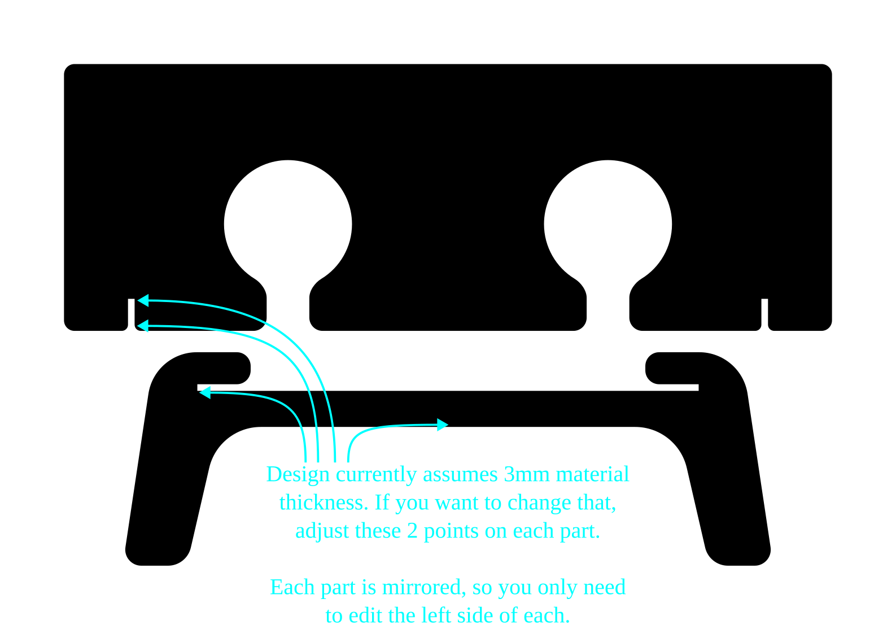

## Material thickness

The design currently assumes it will be cut from 3mm thick material.

If you want to use material of a different thickness, you will need to adjust the thickness of the slots cut into the two parts.
This is simply a matter of adjusting the 2 points on each part, marked in  the picture below.
Bite that the part design is mirrored, so you only need to edit the left side of each.

## Design method

The design was done in [Inkscape](https://inkscape.org/).

It was mostly a matter of drawing the basic shape, doing some calculations to determine the size and position of the slots, cutting the slots with boolean difference operations, then deleting the right side of the design, rounding some corners on the left and mirroring it to the right.
I made individual commits for most of these steps, so looking through the git history should allow you to follow along with the process.
